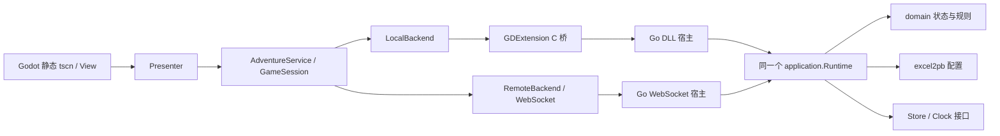

# 权威架构与扩展

## 一份业务核心，两个宿主



Go 内核不引用 Godot，不管理界面节点，也不依赖 WebSocket 连接。`application.Runtime.HandleBytes` 统一解码和处理业务 protobuf；服务器直接使用 Runtime，不通过 DLL。C 桥只负责字符串 ABI、加载 DLL 与释放返回内存；桥接控制包使用 JSON，业务 protobuf 字节通过 Base64 传递。WebSocket 长连接使用二进制消息传输相同业务 protobuf。账号验证可独立使用 HTTP，游戏逻辑不提供 HTTP 请求入口。

Godot View 不查询表；Service 把 protobuf 记录转成业务查询结果；Presenter 将结果转换为已翻译展示文本。客户端展示升级价格等预览信息时可以读取表，但最终校验和扣减一律在 Go 中进行。

## 命令与事务边界

客户端提交操作意图：

```text
protocol_version: 2
id: "session-random-id:42"
type: "equipment.equip"
expected_revision: 7
hero_id: 1
equipment_id: 101
```

上面是便于阅读的 protobuf 文本表示；实际传输使用 `contracts/shared/Command.proto` 定义的二进制命令。`GameResponse.proto` 组合 `gamestate/StateUpdate.proto`、`notification/Notification.proto` 和 `battle/Battle.proto`，各模块公开状态与私有存档分别在 `shared/gamestate/` 和 `server/playerstate/` 下维护。

支持 `snapshot`、`state.sync`、`hero.level_up`、`equipment.equip`、`formation.save`、`campaign.battle`、`idle.claim`。返回 `id/code/update/notifications`（`code="ok"` 表示成功），战斗额外返回 `battle`。首次、状态缺口和业务失败恢复使用完整模块状态；正常成功写命令返回脏模块并附带最新 Idle 视图，装备条目通过绝对值 upsert/删除 ID 通知同步。非法二进制载荷在解码层直接返回错误码，可能没有请求 ID 和状态。

一次写命令按以下顺序执行：互斥串行 → 查已持久化回执 → 校验状态版本 → 克隆工作状态 → 校验/执行规则 → 版本加一 → 状态与 protobuf 回执一起落盘 → 替换当前内存状态 → 清理事务脏标记 → 返回增量。保存失败时整份候选状态和脏标记丢弃，重试重新执行。

- 同 ID、同参数重试返回原回执，不重复扣费或领奖。
- 同 ID、不同参数返回 `request_conflict`。
- 旧版本命令返回 `stale_state`。最近 64 条回执保存后，淘汰的旧请求仍无法使用旧版本重新写入。
- 存盘失败返回 `save_failed`，保持写前状态。
- WebSocket 在握手阶段校验身份和 `gameframe.v2` 子协议，只接收不超过 64 KiB 的二进制消息；共享核心拒绝未知 protobuf 字段、协议版本和非法命令参数。
- 重试回执中的旧快照不会覆盖客户端已经收到的新版本快照。

业务、客户端状态和服务端存档已定义独立 protobuf。`PlayerStateStore` 先验证版本基线，再原子替换收到的模块和合并通知；缺失模块保持原值，明确发来的空列表/零值必须生效。发现缺口时 Session 自动请求完整状态，重复增量不再次触发模块变更。详细约定见 [协议与存档](协议与存档.md)。

## 战斗、时间和防作弊边界

`campaign.battle` 不接收伤害、掉落、胜负或关卡 ID。Go 从自身的当前关卡、英雄、阵容和装备生成双方属性，执行自动战斗，决定奖励并保存。客户端只重放权威战斗事件；“快进”只改变展示速度。

当前战斗是确定性的回合循环，按队伍顺序攻击首个存活目标，技能按 Excel `Every` 周期触发，最多 40 回合。没有实现放置卡牌的完整实时战斗、阵营克制和目标选择机制。后续引入随机数时由 Go 宿主注入权威随机源，客户端仍只消费结果。

挂机使用宿主注入的 `Clock`，按最后领取时刻计算并封顶。客户端没有上传时间差或结算数额的入口。原型固定挂机速率，避免推图后用更高速率追溯整段历史时间。

本地模式的宿主、时间、存档和 DLL 都在玩家控制的设备上，因此只能保证代码复用与正常流程的一致性。在线经济的可信边界是服务器；本地校验不能替代服务端校验。正式在线进度不能从本地存档直接恢复。

## 模式切换与生命周期

`project.godot` 的 `[game] backend` 可设为 `local` 或 `remote`；原型还提供显式切换按钮。本机 `client/override.cfg` 可以覆盖连接设置，Docker 客户端配置脚本将 `server_url` 和 `development_token` 写入该文件，重启客户端生效。

切换会增加会话代数、关闭 WebSocket 并取消重连与待确认命令、关闭本地 handle、清空旧快照，再从新宿主获取快照。旧会话回包不会用于更新当前界面。请求期间暂时禁用切换按钮。在线连接由 RemoteBackend 每帧 poll，包含心跳、连接/响应超时和退避重连；待确认命令在重试期间保留原始字节与 ID，重连后重发，随后通过 state.sync 恢复最新状态。单条命令累计三次连接或响应失败后清除待确认载荷、报告网络错误并解除 busy，后台仍重连和同步；这时命令可能已经在服务器提交。

- 单机文件：Godot `user://offline.pb`。
- 开发服务器文件：`runtime/server.pb`，服务器决定路径。
- Docker 服务器文件：容器 `/data/server.pb`，存放于 Compose 的独立命名卷。
- 测试文件：`build/` 下独立目录，测试不读取玩家默认存档。

Go DLL 使用 handle 映射持有 Runtime，避免一个全局“当前玩家”状态。返回桥接控制包使用 C 分配内存，桥接复制字符串后调用 `GameFree`；控制包中的业务载荷与 WebSocket 使用相同的 protobuf。Go 运行时随进程常驻，GDExtension 标记为不可热重载；模式切换只释放会话，不卸载 Go DLL。

## 后续接入正式服务器

保留 domain/application、生成配置和命令语义。账号服务可以通过 HTTP 登录签发会话凭据，WebSocket 握手验证凭据并绑定玩家 Runtime/事务，而不是接受客户端指定的玩家存档路径。当前服务器在启动时创建一个 Runtime，所有通过 token 验证的连接共享同一个玩家档案，尚无正式账号服务。服务器支持 `-token-file` 读取凭据，Docker 通过 secret 文件提供它；详见 [Docker 部署](Docker部署.md)。

当前 `SaveToDB` 已通过文件 Store 实现：在同目录创建临时文件，写入并同步文件后替换目标。Windows 使用 `MoveFileExW` 替换写穿，Linux 容器使用 `os.Rename`；状态和幂等回执保存在同一份带校验的 protobuf 文件。当前实现未同步父目录，不应将文件替换等同于已经验证断电恢复。新 `.pb` 文件缺失时可从相邻旧 `.json` 文件迁移并保留源文件。后续将文件 Store 替换为数据库事务时，继续确保状态与幂等回执原子提交。

单进程锁只保护当前进程中的 Runtime；多实例部署必须使用数据库版本条件更新、事务/分片归属和全局唯一的请求回执约束。开发 token 不承担正式账号隔离责任。接入真实服务后再补限流、审计、配置版本协商与运维监控。

当前桥接使用 Godot 4.7 C API，Windows x64 的 String/StringName 大小由引擎导出的 `extension_api.json` 确认。其他 ABI 应从对应引擎重新生成头文件并做独立验证。Android 需要 `.so` 和 JNI/NDK 对应构建配置，按项目约定优先在 MuMu 联调。
